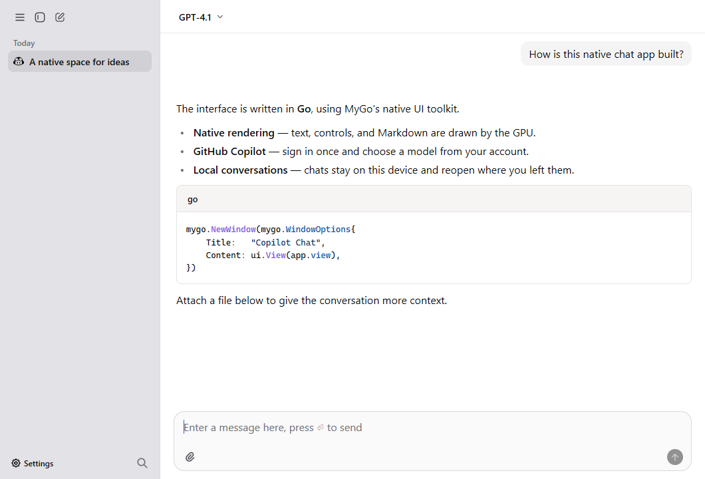

# Copilot Chat

基于 [MyGo](https://github.com/egoist/mygo) 的原生 AI 聊天客户端，支持 GitHub Copilot、Microsoft 365 Copilot，以及豆包、DeepSeek、Claude、Gemini 和 ChatGPT 网页聊天，可在 Windows 和 macOS 上运行。

## 下载与平台

[GitHub Releases](https://github.com/fondoger/copilotchat/releases)



## 功能

- 多账号管理，模型切换、隐藏与置顶。
- 流式 Markdown 回复、代码高亮和 HTML/SVG 预览。
- 图片与文件附件，模型思考选项和 token 用量统计。
- 会话分组、搜索、导出，消息编辑和重新生成。
- MCP 工具、自动生成聊天标题、主题设置和托盘驻留。

## 从源码运行

需要 Go 1.27.1 或更新版本。

```sh
git clone https://github.com/fondoger/copilotchat.git
cd copilotchat
go run .
```

## 文档

- [GitHub Copilot](docs/copilot.md)
- [Microsoft 365 Copilot](docs/m365.md)
- [网页聊天 Providers](docs/web-chat.md)
- [MCP 配置](docs/mcp.md)
- [LLM Gateway / Agent 配置](docs/agents.md)
- [构建与发布](docs/building.md)
