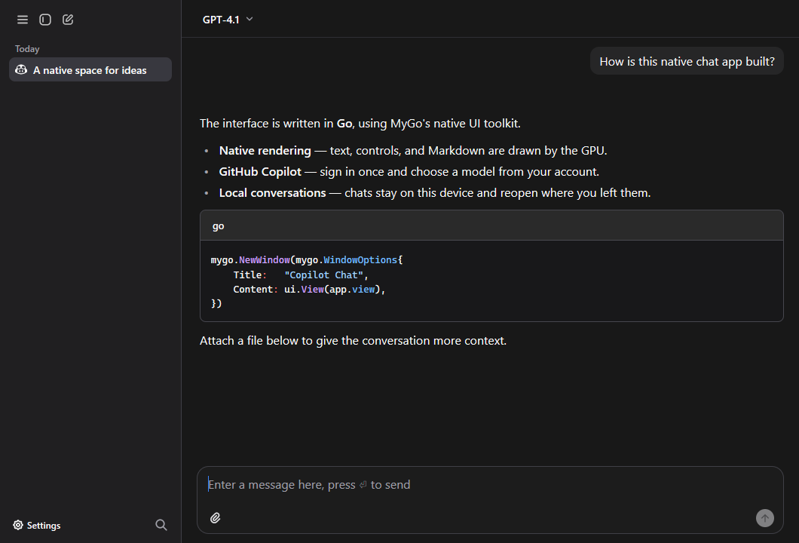

# Copilot Chat

基于 [MyGo](https://github.com/egoist/mygo) 的原生 GitHub Copilot 聊天客户端，使用 Go 绘制界面，支持 Windows 和 macOS。布局参考 ChatWise，提供本地会话、多个 Copilot 账号、附件、模型思考设置和 MCP 工具。

[下载 v0.3.0](https://github.com/fondoger/copilotchat/releases/tag/v0.3.0) · [所有发行版](https://github.com/fondoger/copilotchat/releases) · [问题反馈](https://github.com/fondoger/copilotchat/issues)


截图由原生 UI 测试使用合成会话渲染，不含真实账号或聊天记录。

## 下载与平台

在 [Releases](https://github.com/fondoger/copilotchat/releases) 中选择对应架构。每个发行版同时提供 `SHA256SUMS.txt` 校验文件。

| 系统 | 架构 | v0.3.0 发行文件 |
| --- | --- | --- |
| Windows | x64 / AMD64 | `copilotchat-0.3.0-windows-x64-setup.exe`、`copilotchat-0.3.0-windows-x64.zip` |
| Windows | ARM64 | `copilotchat-0.3.0-windows-arm64-setup.exe`、`copilotchat-0.3.0-windows-arm64.zip` |
| macOS | Intel x64 | `copilotchat-0.3.0-macos-x64.dmg`、`copilotchat-0.3.0-macos-x64.zip` |
| macOS | Apple Silicon ARM64 | `copilotchat-0.3.0-macos-arm64.dmg`、`copilotchat-0.3.0-macos-arm64.zip` |

Windows 安装程序用于安装应用，ZIP 可解压后直接运行。macOS 可从 DMG 将应用拖入 Applications，也可以解压 ZIP。Windows 版本未做代码签名；macOS 使用 ad-hoc 签名，尚未做 Apple notarization，首次运行可能需要通过系统的安全设置确认打开。

Windows x64 已做原生窗口、登录聊天和托盘行为检查。Windows ARM64、macOS Intel 和 Apple Silicon 提供构建目标，但尚未做实机运行验证；CI 测试不能替代真实桌面环境验证。Windows 的 HTML/SVG 预览使用 WebView2，需安装相应运行时。

## 首次连接

1. 打开 **Settings → Providers**，选择 GitHub Copilot。可以添加多个账号，并分别设置名称及 `github.com` 或 `*.ghe.com` 域名。
2. 点击 **Sign in with GitHub**，复制设备码，通过 **Open GitHub** 在浏览器中完成授权。
3. 登录后自动显示用户名并获取可用模型，也可以点击 **Refresh models**。
4. 在聊天顶栏选择模型，输入内容并发送。

每个账号都需要可用的 GitHub Copilot 权益。认证流程参考 [OpenCode v2](https://opencode.ai/v2/docs/providers/#copilot)。每个账号独立保存凭据、模型目录和设置；OAuth token 保存在系统凭据库中，不写入会话 JSON。Enterprise 域名行为通过协议测试验证，尚未使用真实企业账号完成端到端登录验证。

## 功能

- **会话管理**：分组折叠、标题及正文搜索、重命名、收藏、删除和 Markdown 导出；可拖动并保存侧栏宽度。
- **消息与代码**：流式 Markdown、代码高亮、表格、复制、停止和重新生成。编辑用户消息会重新生成并替换其后的消息；编辑 AI 回复会保存新文本供后续对话使用。
- **代码预览**：长代码块可折叠；HTML/HTM/SVG 可在消息内运行，支持内嵌 JavaScript/CSS。预览限制外部网络和本地文件访问，切换会话后释放预览。
- **附件**：UTF-8 文本/代码、PNG/JPEG/GIF/WebP，以及模型声明支持的 PDF。支持粘贴图片、缩略图和打开原图。每个文件最多 5 MB，每条消息最多 10 个文件、合计 20 MB。
- **模型能力**：显示图片、推理、工具和 PDF 能力；根据模型返回的能力提供 thinking effort 或 token budget，并折叠展示服务端返回的可见思考内容。
- **回复详情**：输入、缓存输入和输出 token、首 token 耗时、总耗时及输出速度。缺失的用量显示“—”；缓存命中由服务端决定。
- **多个 Copilot 账号**：添加、改名、禁用和删除，设置自动保存。禁用保留登录；删除保留历史会话。模型目录启动时读取并每 24 小时异步刷新，支持白名单、黑名单和置顶。
- **MCP**：stdio 与 Streamable HTTP，提供配置校验、启用开关和连接测试。每次模型工具调用均展示服务器、工具名及参数，由用户选择 **Allow once** 或 **Deny**。
- **Chat Title**：首轮回复后自动生成标题，可选择模型或关闭。标题生成使用所选模型的正常请求额度。
- **原生设置**：跟随系统、浅色和深色主题，聊天字号，Enter / Ctrl+Enter 发送，以及可选托盘驻留。

托盘驻留默认关闭。开启后，关闭主窗口会隐藏窗口并保留进程；点击托盘图标恢复，右键菜单可新建聊天、打开设置或退出。输入框保留附件、模型思考选项和发送/停止操作；设置包含 General、Appearance、Providers、MCP、Extensions。



常用快捷键：`Ctrl+N` 新建会话、`Ctrl+,` 设置、`Ctrl+B` 切换侧栏、`Ctrl+F` 搜索会话、`Escape` 停止回复、`Shift+Enter` 换行。macOS 对应的主修饰键为 `Command`。

## 本地数据

会话、附件、设置和工具上下文保存于 `state.json`，默认目录为 Windows 的 `%APPDATA%\Copilot Chat` 或 macOS 的 `~/Library/Application Support/Copilot Chat`。`--data-dir <目录>` 可指定其他数据目录，但不改变系统凭据库的命名空间。

发送消息时，会话上下文及其中的附件会交给所选 Copilot 模型。MCP 环境变量配置保存在本地设置中；秘密值可通过应用继承的环境变量提供。只启用可信的 MCP 程序和服务器。协议及配置示例见 [MCP 文档](docs/mcp.md)。

## 从源码运行

需要 Go 1.27.1 或更新版本；启用自动工具链的旧版 Go 会根据 `go.mod` 下载所需版本。

```sh
git clone https://github.com/fondoger/copilotchat.git
cd copilotchat
go run .
```

运行测试与静态检查：

```sh
go test ./...
go vet ./...
```

发布包使用 PowerShell 7 和 MyGo 构建。例如在 Windows x64 主机上：

```powershell
pwsh ./scripts/package.ps1 -Platform windows/amd64
```

输出位于 `release/`。其他架构的命令、CI 和标签发布流程见 [构建与发布](docs/building.md)。协议测试使用本地 mock server，无需账号，也不消耗 Copilot 额度。

## 文档与来源

- [Copilot 认证、模型与推理协议](docs/copilot.md)
- [MCP 配置与限制](docs/mcp.md)
- [构建与发布](docs/building.md)
- [UI 设计参考](docs/ui-reference.md)
- [第三方依赖与图标说明](THIRD_PARTY_NOTICES.md)

界面参考 ChatWise，并经其作者授权使用相关图标。各开源图标和依赖的许可证随源码及发行包提供。GitHub Copilot 名称和标识属于其各自权利人。
